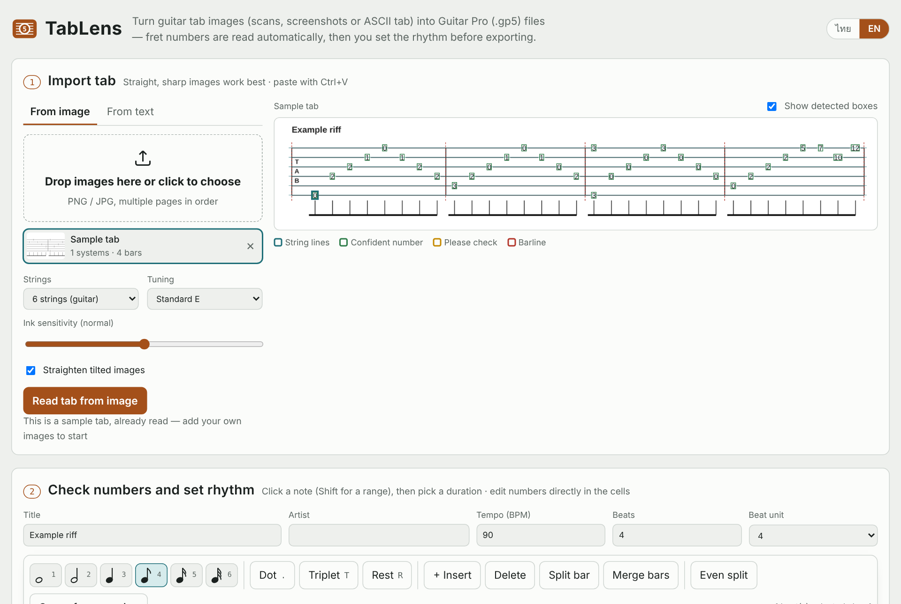
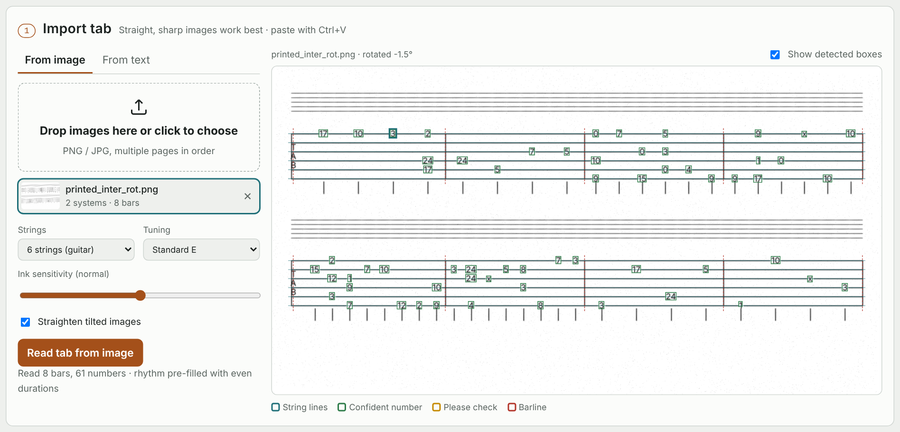
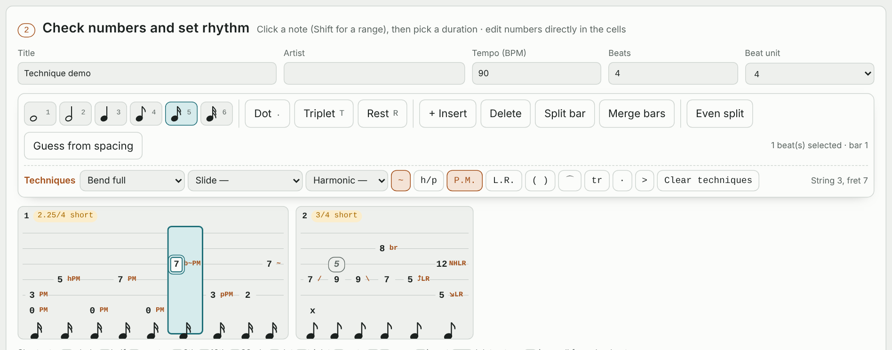
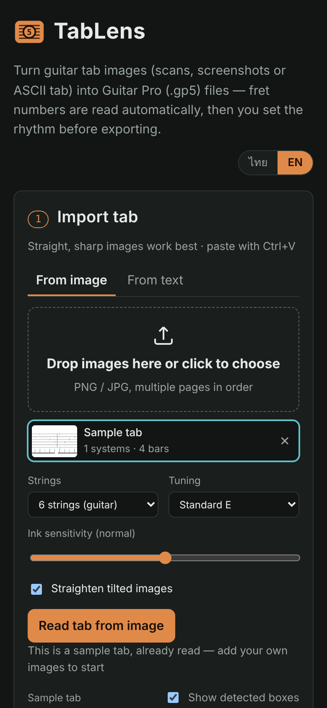
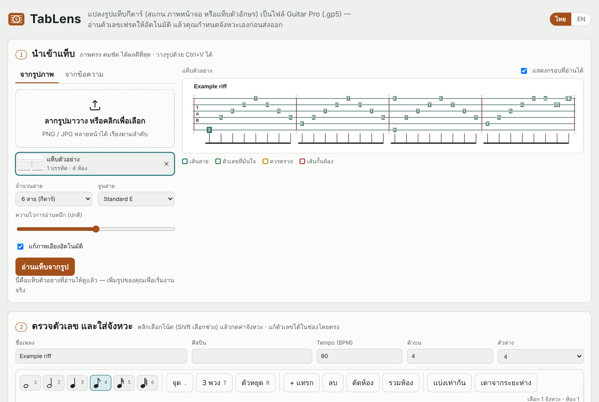

<p align="center">
  
</p>

<h1 align="center">TabLens</h1>

<p align="center">
  Turn guitar tab images into <b>Guitar Pro 5 (.gp5)</b> files, right in your browser.<br>
  แปลงรูปแท็บกีตาร์เป็นไฟล์ <b>Guitar Pro 5 (.gp5)</b> ได้ในเบราว์เซอร์
</p>

<p align="center"><a href="#english">English</a> · <a href="#ภาษาไทย">ภาษาไทย</a></p>

---

## English

TabLens reads tab from scans, screenshots and ASCII tab, lets you fix numbers, set the rhythm and add playing techniques, then exports a Guitar Pro 5 file. Everything runs locally in the browser; no install and no upload (unless you choose **Read with Claude AI**). The interface is available in English and Thai.

### Quick start

1. Download or clone this repo.
2. Open `dist/index.html` in Chrome, Edge or Firefox.

That's it. If GitHub Pages is enabled for this repo (Settings → Pages → branch `main`, folder `/`), the app is also at `https://<user>.github.io/TabLens/`.

### 1. Import a tab

Drop, choose or paste (Ctrl+V) one or more images, or paste ASCII tab into **From text**. Pick the number of strings (4–7) and the tuning.



The preview shows what was recognised: string lines, fret numbers (green = confident, yellow = please check) and barlines. Tilted images are straightened automatically; this example was rotated 1.5° with added noise.

### 2. Check numbers, set rhythm and techniques



- **Numbers**: type in any cell; `x` is a dead note. Uncertain numbers are underlined in yellow.
- **Rhythm**: select beats (Shift for a range), then press a duration or use keys `1`–`6` (whole … 32nd), `.` dot, `T` triplet, `R` rest. Each bar shows whether it is full, short or over. **Even split** and **Guess from spacing** give you a starting point.
- **Bars**: insert, delete, split and merge.
- **Techniques**: bend (½, full, 1½, 2, release, prebend), vibrato, hammer-on/pull-off, slides (legato, shift, in/out), palm mute, let ring, harmonics (NH/AH/PH/TH/SH), ghost note, tie, tremolo picking, accent and staccato. Click a number, then press a key (`H` `B` `V` `S` `M` `L` `G` `N` `A`) or use the toolbar. Short marks such as `h`, `b~` or `PM` appear next to the number.
- **Undo** with Ctrl+Z. Your work is kept in this browser.

### 3. Listen and export

- **Play** previews the tab with a plucked-string synth, including bends, slides, vibrato, palm mute and harmonics.
- **Download .gp5** opens in Guitar Pro 5–8, TuxGuitar and MuseScore.
- **Copy as text tab** gives you ASCII tab with technique marks.

### What gets recognised automatically

| Source | Numbers & bars | Techniques |
|---|---|---|
| Pasted text tab | ✓ | `5h7` `7p5` `5/7` `/5` `5\` `7b9` `8b10r8` `7~` `(5)` `<12>`, plus `PM----` / `let ring---` lines above the staff |
| Image of a text tab | ✓ | h p b r / \ and ghost parentheses |
| Printed tab (Guitar Pro, books) | ✓ | Bend arrows and vibrato lines are not read yet; add them in the editor or use **Read with Claude AI** |

**Read with Claude AI** appears only when the page runs as a claude.ai Artifact; it sends the image to Claude and uses your Claude usage.

<p align="center"></p>

### Limitations

- GP5 stores titles in a Latin code page, so non-Latin characters (such as Thai) become `?`.
- Heavily skewed or blurry phone photos read poorly; crop to just the tab or use Claude AI.
- One track, one voice and one time signature per song.

---

## ภาษาไทย

TabLens อ่านแท็บจากรูปสแกน ภาพหน้าจอ และแท็บตัวอักษร ให้คุณแก้ตัวเลข ใส่จังหวะ และใส่เทคนิคการเล่น แล้วส่งออกเป็นไฟล์ Guitar Pro 5 ทุกอย่างทำงานในเบราว์เซอร์ ไม่ต้องติดตั้ง และไม่ส่งรูปออกไปไหน (ยกเว้นเมื่อกด **อ่านด้วย Claude AI**) หน้าเว็บเลือกได้ทั้งภาษาไทยและอังกฤษ (ปุ่ม ไทย / EN มุมขวาบน)



### เริ่มใช้งาน

1. ดาวน์โหลดหรือ clone repo นี้
2. ดับเบิลคลิก `dist/index.html` ให้เปิดใน Chrome, Edge หรือ Firefox

ถ้าเปิด GitHub Pages ไว้ (Settings → Pages → branch `main` โฟลเดอร์ `/`) จะเข้าได้ที่ `https://<user>.github.io/TabLens/`

### ขั้นตอน

1. **นำเข้าแท็บ** — ลากรูปมาวาง เลือกไฟล์ หรือกด Ctrl+V (หลายหน้าได้) หรือวางแท็บข้อความในแท็บ "จากข้อความ" เลือกจำนวนสาย (4–7) และจูนสาย ภาพตัวอย่างด้านขวาจะแสดงเส้นสาย ตัวเลขที่อ่านได้ (เขียว = มั่นใจ, เหลือง = ควรตรวจ) และเส้นกั้นห้อง
2. **ตรวจตัวเลขและใส่จังหวะ** — แก้ตัวเลขในช่องได้เลย (`x` = dead note) เลือกโน้ตแล้วกดค่าโน้ตหรือคีย์ `1`–`6`, `.` ประจุด, `T` สามพวง, `R` ตัวหยุด แต่ละห้องบอกว่าจังหวะครบ ขาด หรือเกิน มีปุ่ม "แบ่งเท่ากัน" และ "เดาจากระยะห่าง" ช่วยเริ่มต้น
3. **เทคนิค** — bend (½, เต็ม, 1½, 2, ปล่อย, prebend), vibrato, hammer-on/pull-off, slide, palm mute, let ring, harmonic (NH/AH/PH/TH/SH), ghost, tie, tremolo picking, accent, staccato คลิกตัวเลขแล้วกดคีย์ `H` `B` `V` `S` `M` `L` `G` `N` `A` หรือใช้แถบเครื่องมือ
4. **ฟังและส่งออก** — ฟังตัวอย่าง (มีเสียง bend, slide, vibrato) ดาวน์โหลด `.gp5` หรือคัดลอกเป็นแท็บข้อความ

ตารางว่าอ่านอะไรได้อัตโนมัติ และข้อจำกัด ดูในส่วนภาษาอังกฤษด้านบน สรุปสั้นๆ: แท็บข้อความอ่านเทคนิคได้เกือบครบ, รูปแท็บข้อความอ่าน h p b r / \ และวงเล็บได้, แท็บพิมพ์แบบ Guitar Pro ยังอ่านลูกศร bend และเส้น vibrato ไม่ได้ ชื่อเพลงภาษาไทยจะกลายเป็น `?` เพราะ GP5 รองรับเฉพาะอักษรละติน

---

## For developers

```
src/shell.html     HTML + CSS
src/i18n.js        Thai / English strings
src/app.js         editor, rhythm, techniques, playback, export
src/tabocr.js      image → staves, barlines, fret numbers, technique marks
src/gp5writer.js   Guitar Pro 5 writer (port of PyGuitarPro's write path)
tools/build.py     builds dist/index.html (standalone) and dist/artifact.html
tools/screenshots.py   regenerates docs/screenshots
tests/             GP5 byte-compare, OCR benchmark, UI smoke test
```

The OCR is written from scratch (no Tesseract): row projection finds staff lines, the image is deskewed, staff lines are removed, connected components are grouped, and digits are matched against templates rendered from the browser's own fonts.

```bash
python3 tools/build.py                                  # rebuild dist/ after editing src/
pip install pyguitarpro && bash tests/test_gp5.sh       # JS writer == PyGuitarPro, byte for byte
pip install playwright && playwright install chromium
python3 tests/ocr_benchmark.py                          # 243/246 beats on 6 synthetic images
python3 tests/ui_smoke.py                               # both languages, end to end
python3 tools/screenshots.py                            # refresh README images
```
